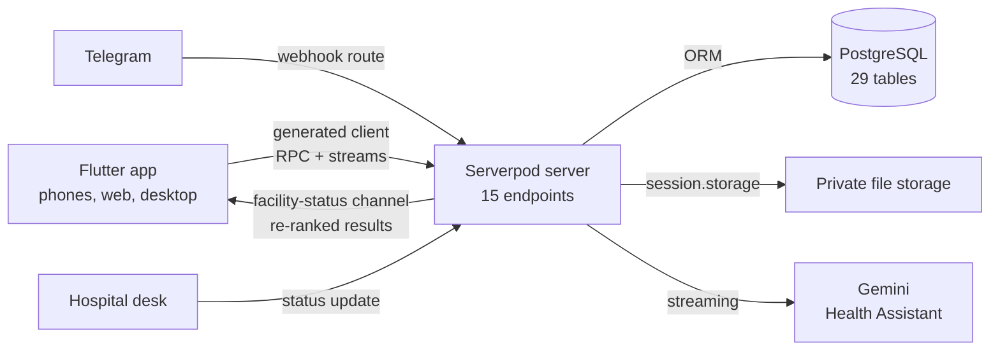

# EmergencyHr

## Which hospital near me can take this patient right now?

EmergencyHr answers that question in under two minutes for people in a Nigerian emergency. Hospitals publish their live availability, the public taps one Emergency button, and the app ranks nearby hospitals by who can actually receive a patient, with one tap to call or get directions. One Flutter app runs on phones, the web and desktop, and one Serverpod backend powers all of it.

**Live app:** [emergencyhr.serverpod.space](https://emergencyhr.serverpod.space)
**Telegram bot:** [@EmergencyHrBot](https://t.me/EmergencyHrBot)

---

## The problem

> In Lagos and other Nigerian cities, families in an emergency often drive from hospital to hospital, only to be told at the gate that there is no bed, no doctor on duty, or a deposit to pay first. Minutes are lost in traffic between rejections. Nobody publishes, in one place, which hospital can take a patient right now.

---

## What the app does

### One button for the public, one screen for each hospital

The public needs no account. Tapping Emergency starts the location lookup and opens Hospitals near you. The server ranks hospitals within 10 km (25 km if none qualify) into tiers by freshness and fitness for the emergency type, then by travel time and free beds. Stale data is never shown as accepting. Every label below is the app's real copy:

| Label | When it shows |
| --- | --- |
| 🟢 **Accepting emergencies. Confirmed 12 min ago.** | The hospital's own desk confirmed it within 30 minutes. |
| 🟠 **Last confirmed 45 min ago. Call ahead.** | 30 to 120 minutes old. |
| ⚪ **Unverified. Call before going.** | Not live yet, flagged by the public, or older than two hours. |

#### People in an emergency
- Ranked hospitals, live updates while the list is open
- Call or directions in one tap, then first aid and a family alert
- Area picker when location is off, so it is never a dead end
- Health Assistant that routes red-flag symptoms to Emergency
- The same search on Telegram, no app needed

#### Hospital desks
- Status update in under 30 seconds, one-handed
- Accepting or paused, ER and ICU beds, doctor, deposit
- "Still accurate" to refresh the time without changes
- Update from Telegram once connected
- Every change logged under the staff member's name

#### Field agents
- Onboard hospitals on site, with duplicate detection
- Go-live checklist per hospital
- Invite hospital admins and desk staff
- Confirm the desk phone with a test call

#### Platform admins
- Verification queue and bulk verify
- Imported 683 real hospitals (Lagos, Ogbomoso) from GRID3
- Pipeline, freshness, wrong-status reports, metrics
- Suspend hospitals or accounts, with an audit trail

---

## How it uses Serverpod

### Serverpod is the whole backend: API, database, real time, auth, files, web hosting and deployment

There is no other server, no separate API gateway and no hand-written HTTP client. Every feature in the app goes through Serverpod endpoints, Serverpod models and the Serverpod ORM, and the app and server share one set of generated, type-safe classes.

| 15 | 101 | 29 | 31 | 22 | 6 | 210 |
| :---: | :---: | :---: | :---: | :---: | :---: | :---: |
| endpoint classes | `.spy.yaml` models | database tables | relations | enums | typed exceptions | server tests |

#### Type-safe calls from Flutter to the server
`endpoints · generated client`

Fifteen endpoint classes (emergency, status, facility, onboarding, admin, assistant, telegram and more) are the only way the app reaches data. Serverpod generates the Dart client, so the Flutter app calls the server like a local function, with the same model classes on both sides.

```dart
final search = await client.emergency.start(
  lat, lng, EmergencyType.burns);
```

#### 101 models, 29 tables, one schema language
`models · ORM · PostgreSQL`

Every table, enum and API object is a `.spy.yaml` model: facilities, live statuses, audit logs, onboarding records, invites, claims, encrypted chat. Relations cascade, unique indexes block duplicate imports, and `serverOnly` models (like Telegram link codes) never reach the app.

#### Data you can trust under pressure
`transactions · batched queries`

28 database transactions keep multi-row writes consistent: a status change and its audit entry, a claim, an invite, a bulk verify of 100 hospitals. Lists use batched `inSet` queries; the admin pipeline went from about 1,750 queries per load to about 7.

#### Live ranking while you look at it
`streams · session.messages`

When a desk saves a status, the server posts a message on the `facility-status` channel. Every open results screen is subscribed through a streaming endpoint, so it gets a freshly ranked list within seconds. If the socket drops, the app falls back to polling.

```dart
Stream<EmergencySearch> watch(Session session, ...) async* {
  final updates = session.messages
      .createStream<FacilityStatusChanged>('facility-status');
  ...
}
```

#### Health Assistant answers stream in
`streaming endpoint · AI`

`assistant.send` returns `Stream<ChatEvent>`. Deterministic red-flag rules run on the server before the model; Google Gemini's answer streams through Serverpod to the app word by word. A red flag shows "Find emergency care now", which opens the Emergency flow. Chat is encrypted at rest.

#### Accounts and roles
`serverpod_auth_idp · JWT`

Email and password sign-in uses Serverpod's identity provider with JWT sessions, and Serverpod Cloud sends the verification emails. An account-created hook creates the app's user record and grants the first platform admin. One `AuthGuard` checks roles on every endpoint, deny by default, including hospital-scoped roles.

#### Private hospital documents
`session.storage`

Registration documents are stored in Serverpod's private cloud storage. Uploads go through an endpoint as `ByteData` (10 MB limit), and only platform admins or the hospital's managers can download them.

#### The same server hosts the web app and the bots
`web server (Relic) · routes`

Serverpod's web server serves the Flutter web app and the landing page at the root address, plus a route that tells the web app where the API lives. Webhook routes receive Telegram updates (checked against a secret header) and WhatsApp messages (checked with an HMAC signature).

#### Scheduled reminders
`future calls`

A recurring future call runs every five minutes to remind desks whose status is over an hour old, and to alert field agents when a new hospital goes quiet. Hosts with future calls switched off skip the schedule instead of failing to start.

#### Secrets and settings per environment
`passwords · run modes · config`

API keys, the Telegram token, the encryption key and hashing peppers live in Serverpod passwords (Serverpod Cloud secrets in production), never in code. Development, test, staging and production each have their own settings and feature flags.

#### 210 tests against a real database
`serverpod_test`

Integration tests use `withServerpod` to call real endpoints with authenticated sessions against a Serverpod-managed PostgreSQL. No Docker needed. Pure rules (ranking, freshness, go-live, red flags) have fast unit tests.

#### Ship with one command
`migrations · Serverpod Cloud`

Schema changes go through Serverpod migrations, applied automatically when the server starts. `scloud deploy` generates code, builds the Flutter web app into the server and rolls out API and web together to emergencyhr.serverpod.space.

> ### Serverpod's own logs found our worst bug
> After we imported 683 hospitals, the admin Pipeline page stopped loading in production. Serverpod's session log for that request showed `numQueries=1753`. We batched the go-live checks into four queries, added a test, and redeployed the same day. Later, a session log's stack trace pointed straight at a typed-set bug in the field agents' list.

---

## How it uses Flutter

### One codebase for every screen the problem needs

- **Android, iOS, web, macOS, Windows and Linux** from one Flutter project. The public web landing page is Flutter too.
- **MVVM with Stacked:** views only lay out widgets, and every rule lives in a view model, so the 87 Flutter tests cover the behaviour.
- **Four role-based shells:** Public, Hospital desk, Field agent and Admin, chosen from the signed-in user's roles.
- **Built for bad networks:** the last results are cached on the device (Hive), ages tick down on the device and only ever get worse, and live updates fall back to polling.
- **Device features:** location (with a fast network fix on the web), one-tap phone calls, map directions, document picking and the device's SMS app for family alerts.
- **A real design system:** shared widgets and colour tokens in light and dark themes.

---

## Architecture

### How the pieces connect



---

## Status

### What is live today

| Part | State |
| --- | --- |
| **Web app and API** | Live on Serverpod Cloud at emergencyhr.serverpod.space |
| **Emergency search** | Live, no account needed, 683 real hospitals in Lagos and Ogbomoso (locations from GRID3, CC BY 4.0) |
| **Hospital status, onboarding, admin** | Live; a hospital goes live once it is verified, has a hospital admin and sends a real status |
| **Health Assistant** | Live with Google Gemini |
| **Telegram bot** | Live: hospital search for anyone, status updates for connected staff |
| **Phone apps** | Android and iOS builds connect to the live server |
| **SMS and WhatsApp** | Built behind adapters; switched off until provider accounts are set up |
| **Scheduled reminders** | Built as a future call; waiting on future calls being enabled for the Cloud project |

---

EmergencyHr. Built with Flutter and Serverpod 4.
